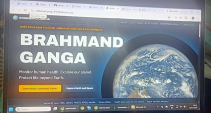
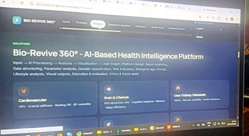
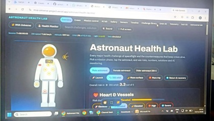
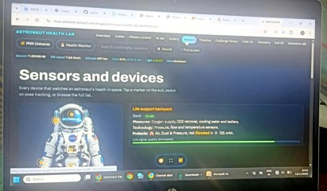
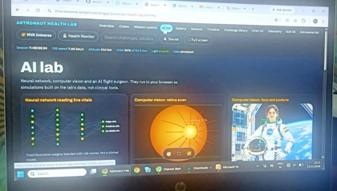
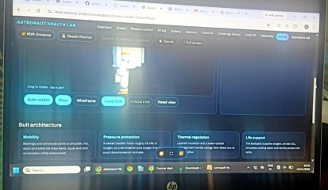
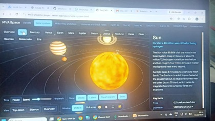
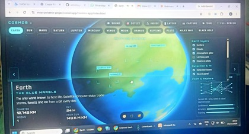
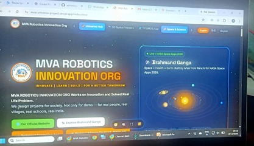
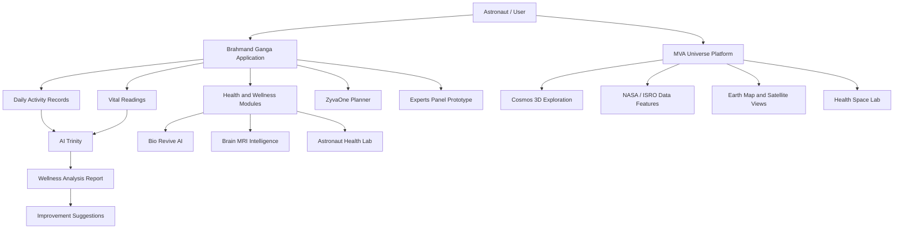

# 🚀 BRAHMAND GANGA

### Beyond Health Monitoring — A Complete Astronaut Support Ecosystem for Space and Earth

**From the infinite universe to the deepest oceans and frozen polar worlds — explore beyond boundaries with Brahmand Ganga.**

<p align="center">
  <strong>NASA Space Apps Challenge 2026 | Regional Round Project</strong><br>
  <strong>Team Reborn Innovators</strong><br>
  <strong>MVA Robotics Innovation Org</strong>
</p>

<p align="center">
  <a href="https://mva-universe-project.vercel.app/">🌌 Main Platform</a> •
  <a href="https://brahmand-ganga.vercel.app/">🛰️ Live Demo</a> •
  <a href="https://brahmand-ganga-cosmic-gateway.vercel.app/">🚀 Cosmic Gateway</a> •
  <a href="https://github.com/mva-robotics-innovation/brahmand-ganga">💻 Brahmand Ganga Repository</a> •
  <a href="https://youtu.be/9CHAgphoEac">▶️ Project Demonstration</a>
</p>

---

---


---

## 🌍 1. Our Vision

**Brahmand Ganga** is an astronaut-support and space-exploration ecosystem developed by **MVA Robotics Innovation Org**, under **Team Reborn Innovators**.

Our idea goes beyond conventional astronaut health monitoring. We aim to bring health awareness, wellness screening, mission preparation, daily activity management, space exploration, and astronaut assistance into one connected digital ecosystem.

Astronauts need support not only during space missions but also before missions, while living with their families on Earth, and throughout their return to everyday life.

Brahmand Ganga is designed around this complete journey.

**One platform. Two environments. One connected astronaut-support vision.**

- **On Earth:** Monitor daily routines, review vital readings, understand wellness trends, organise activities, and prepare for upcoming missions.
- **In Space:** Access astronaut-oriented health interfaces, scheduling tools, space exploration experiences, and visualisation concepts designed for mission environments.

Our central belief is simple:

> Space exploration should advance alongside human well-being. Technology should help astronauts explore the universe while taking care of themselves.

---
## 🖼️ Project Screenshots & Interface Preview

Explore the actual interfaces and visual modules developed for BRAHMAND GANGA and the MVA Universe ecosystem.

### 1. Brahmand Ganga — Main Platform


### 2. Bio Revive AI — Health Intelligence


### 3. Astronaut Health Lab


### 4. Astronaut Suit — Vital Sensor Visualisation


### 5. AI Lab — Computer Vision


### 6. 3D Space Suit Architecture


### 7. Interactive 3D Solar System


### 8. Cosmos — Earth Explorer


### 9. MVA Robotics Innovation Org


## 🎯 2. The Problem We Aim to Address

Space missions create demanding physical, mental, operational, and environmental challenges.

Astronauts may need to manage:

- Changes in daily routines and sleep schedules.
- Health and vital-sign monitoring.
- Mission preparation and personal activity planning.
- Limited access to familiar Earth-based environments.
- Physical and wellness challenges during long-duration missions.
- Different equipment and accessibility considerations for female, older, and differently abled astronauts.
- The need to access space-related information and visual resources from a workstation.

Health monitoring alone does not address all these needs.

**Our approach:** Bring several astronaut-support capabilities together through one digital ecosystem, with dedicated applications and interactive modules.

---

## 💡 3. Our Proposed Solution

Brahmand Ganga combines five major pillars.

| Pillar                           | Purpose                                                                    |
| -------------------------------- | -------------------------------------------------------------------------- |
| AI Wellness Intelligence         | Daily activity analysis and wellness-screening reports                     |
| Astronaut Health Support         | Face-analysis and health-space visualisation prototypes                    |
| Mission Readiness & Productivity | Daily planning, reminders, and schedule management                         |
| Space Exploration                | Interactive 3D celestial bodies and space information                      |
| Inclusive Astronaut Design       | Visual concepts for astronaut suits and accessibility-oriented experiences |

The ecosystem includes a main MVA Universe platform and a dedicated Brahmand Ganga application, supported by separate AI and visualisation modules.

---

## 🧬 4. Core Modules and Features

### 4.1 Brahmand Ganga — Main Astronaut Health Application

**Main application:** [https://brahmand-ganga.vercel.app/](https://brahmand-ganga.vercel.app/)

Brahmand Ganga is the central health and astronaut-support application.

It is designed to collect daily activity information and vital readings entered by the astronaut, then use AI-assisted analysis to generate a wellness report.

The astronaut can enter information such as:

- Heart rate / heartbeat.
- SpO₂ readings.
- Smoking habits.
- Alcohol consumption.
- Daily screen time across computer, laptop, and mobile.
- Sleep duration.
- Daily routine and activity information.

Vital readings are intended to come from the Space Health Centre or other suitable measurement sources and be entered into the application.

**AI Trinity workflow:**

1. Astronaut records daily activity and available vital readings.
2. The application organises the submitted information.
3. AI Trinity analyses the provided information.
4. The system generates a wellness-oriented analysis report.
5. The report provides suggestions for potential lifestyle and routine improvements.

The purpose is to help astronauts understand their wellness information and prepare for missions while they are still on Earth.

### 4.2 AI Trinity — Wellness Analysis

AI Trinity is the analysis layer of the Brahmand Ganga ecosystem.

It focuses on interpreting submitted daily activity and vital information and presenting understandable feedback.

Its intended outputs include:

- Summary of submitted wellness information.
- Activity and routine observations.
- Sleep and screen-time observations.
- Vital-reading summaries.
- Suggestions for improvement.
- Mission-preparation awareness.

**Important:** AI Trinity is a wellness-screening prototype. Its reports are not clinical diagnoses, and recommendations must not replace qualified medical advice or astronaut medical-team decisions.

### 4.3 Bio Revive AI — Health Intelligence

**Live application:** [https://bio-revive-ai-genius.vercel.app/](https://bio-revive-ai-genius.vercel.app/)

Bio Revive AI is a connected health-intelligence module within the wider project ecosystem.

It supports the project's health-analysis experience and is presented alongside the Brahmand Ganga Health Panel.

### 4.4 Brain MRI Intelligence

**Live application:** [https://brain-mri-intelligence.vercel.app/#workstation](https://brain-mri-intelligence.vercel.app/#workstation)

Brain MRI Intelligence is a separate AI-oriented brain MRI analysis workstation included in the health ecosystem.

It demonstrates an additional medical-imaging intelligence concept.

It should be treated as a prototype analysis tool, not as an independently validated diagnostic system.

### 4.5 Astronaut Health Lab — Computer Vision Face Analysis

**Live application:** [https://mva-universe-project.vercel.app/astronaut-health-lab.html](https://mva-universe-project.vercel.app/astronaut-health-lab.html)

The Astronaut Health Lab explores computer-vision-based facial observation.

The prototype is designed to examine visible facial characteristics such as:

- Eye redness.
- Facial texture.
- Facial appearance and visible changes.
- Active-looking or dull-looking appearance.
- Facial gestures and expressions.

The goal is to explore how computer vision could contribute to an astronaut-oriented wellness interface.

**Technical consideration:** Camera-based facial observations are not equivalent to medical measurements. Lighting, camera quality, individual differences, and environmental conditions can affect results.

### 4.6 Experts Panel — Doctors and Health Experts

The Brahmand Ganga frontend includes an Experts Panel concept.

**Frontend:** [https://brahmand-ganga-frontend.vercel.app/](https://brahmand-ganga-frontend.vercel.app/)

The panel demonstrates how astronauts could potentially connect with relevant medical and health professionals.

Proposed interaction capabilities include:

- Viewing expert profiles.
- Reviewing displayed ratings.
- Checking availability, such as today or tomorrow.
- Exploring free-session and consultation options.
- Accessing health-related expert support.
- AI-assisted suggestions for possible next steps.

**Prototype disclosure:** All expert and doctor profiles currently displayed are demonstration/sample profiles, not verified real doctors. Actual medical consultations, professional verification, appointment systems, and clinical integrations require real expert onboarding and appropriate validation.

---

## 🧑‍🚀 5. Pre-Mission and In-Space Support

Brahmand Ganga considers astronaut support as a continuous journey rather than a feature used only during a mission.

### Before a mission — On Earth

Astronauts can use the ecosystem to:

- Record their daily routines.
- Review available vital readings.
- Understand wellness-screening reports.
- Identify areas where their routines may need improvement.
- Organise tasks and reminders.
- Prepare for upcoming mission schedules.
- Maintain a connection between personal life and mission readiness.

This can be particularly useful during the period when astronauts are living with their families and preparing for a mission.

### During a mission — In Space

The project explores dedicated interfaces for:

- Astronaut-oriented health monitoring.
- Facial observation through computer vision.
- Daily activity and schedule management.
- Interactive space exploration.
- Health Space Lab visualisation.
- Space-related information access through a workstation.

The current project is a software and visualisation prototype. Operational integration with spacecraft systems, certified medical equipment, and mission-control infrastructure would require additional engineering, testing, and approvals.

---

## 📅 6. ZyvaOne — Astronaut Productivity and To-Do Planner

Astronaut support also requires effective daily activity management.

**ZyvaOne** is the project's productivity and planning concept.

It allows users to organise their activities through:

- To-do lists.
- Daily task planning.
- Reminders.
- Calendar pin options.
- Personal activity organisation.

The purpose is to support astronauts both on Earth and in space by giving them a dedicated way to organise their schedules.

---

## 🌌 7. Cosmos App — Interactive Space Exploration

**Live application:** [https://mva-universe-project.vercel.app/cosmos-app/index.html](https://mva-universe-project.vercel.app/cosmos-app/index.html)

The Cosmos experience brings interactive space exploration into the Brahmand Ganga ecosystem.

It is designed to help users explore celestial objects through interactive 3D visualisations.

### Space exploration features

- Sun and Solar System exploration.
- Earth and Mars visualisations.
- All major planets.
- Dwarf planets.
- Related celestial objects.
- Milky Way galaxy exploration.
- Black-hole visualisation.
- Distance-related parameters where available.
- Rotating and repositioning 3D objects.
- Changing viewing angles.
- Interactive navigation through space scenes.

The experience is intended to make space information more accessible and engaging, including from an astronaut workstation.

### Computer Vision Exploration

The Cosmos experience also explores computer-vision-based object detection.

The concept is to identify objects appearing within a camera's field of view and display detection information.

Actual detection performance depends on the deployed model, available camera, lighting, and test environment.

### NASA and ISRO Data

The project incorporates NASA API and ISRO-related data/API exploration into its space-information experience.

The specific data available depends on the connected API, service availability, and integration status.

Useful official resources:

- NASA Open APIs: [https://api.nasa.gov/](https://api.nasa.gov/)
- NASA: [https://www.nasa.gov/](https://www.nasa.gov/)
- ISRO: [https://www.isro.gov.in/](https://www.isro.gov.in/)

---
## 🚀 8. Brahmand Ganga — Cosmic Gateway: Immersive Exploration Tours

**Experience:** [🌌 Open Brahmand Ganga Cosmic Gateway](https://brahmand-ganga-cosmic-gateway.vercel.app/)

The **Brahmand Ganga Cosmic Gateway** expands our space-exploration experience into an immersive collection of interactive tours. It takes users beyond conventional space dashboards and introduces cinematic journeys through the universe, satellite systems, rocket missions, oceans, marine life, and polar environments.

The platform is designed to provide an engaging exploration experience through interactive 3D environments, camera movement, tour controls, and visual storytelling.

### 8.1 Cosmos Tour — Journey at the Speed of Light

[🌌 Start Cosmos Tour](https://brahmand-ganga-cosmic-gateway.vercel.app/)

Explore a journey from Earth towards the wider universe through the ASTRA-VISION X1 camera-satellite concept.

Features include:

- Light-speed journey and distance visualisation.
- Interactive exploration of planets and celestial objects.
- 360° camera viewing and rotation.
- Automatic tour and manual exploration modes.
- Surface, close-up, cutaway, and core viewing concepts.
- Zoom and field-of-view controls.
- Thermal and spectral visualisation modes.
- Exploration of stars, nebulae, galaxies, and black holes.

### 8.2 Satellite Tour — Satellites of the World

[🛰️ Start Satellite Tour](https://brahmand-ganga-cosmic-gateway.vercel.app/satellites.html)

Explore the satellites that observe, connect, guide, and support our world.

The tour covers satellite-related topics such as:

- Historical satellite missions.
- Earth-observation satellites.
- Weather and navigation satellites.
- Space telescopes, including the James Webb Space Telescope.
- Space stations and orbital systems.
- ISRO-related satellite and exploration missions.
- Moon and Mars orbiters.
- Space debris awareness.

### 8.3 Rocket Missions — Interactive Launch Experience

[🚀 Explore Rocket Missions](https://brahmand-ganga-cosmic-gateway.vercel.app/rockets.html)

The Rocket Missions experience introduces users to rocket-launch sequences and mission concepts through an interactive launch console.

Features include:

- Rocket and payload selection.
- Launch sequence simulation.
- Ignition and liftoff controls.
- Stage and fairing separation.
- Payload deployment sequence.
- Mission elapsed-time display.
- Altitude and velocity visualisation.
- Manual and automated launch interaction concepts.

This is an educational and visual launch simulation, not a live rocket-control system.

### 8.4 Ocean Tour — Explore the Deep Blue

[🌊 Start Ocean Tour](https://brahmand-ganga-cosmic-gateway.vercel.app/ocean.html)

Move from outer space to Earth's oceans and explore underwater environments.

The experience introduces ocean and underwater exploration concepts, including:

- Oceans and deep-sea environments.
- Ocean trenches and underwater zones.
- Depth visualisation.
- Water pressure and temperature displays.
- Sunlight and underwater environmental parameters.
- Interactive underwater camera exploration.

### 8.5 Sea Life Tour — Explore Marine Biodiversity

[🐬 Start Sea Life Tour](https://brahmand-ganga-cosmic-gateway.vercel.app/Sea%20Life%20Tour.html)

Discover marine biodiversity through an interactive sea-life exploration experience.

The concept focuses on:

- Marine species exploration.
- Underwater environments.
- Visual discovery of sea life.
- Interactive navigation between scenes.
- Awareness of ocean ecosystems and biodiversity.

### 8.6 Antarctica Tour — Explore the Frozen Continent

[❄️ Explore Antarctica Tour](https://brahmand-ganga-cosmic-gateway.vercel.app/)

The Antarctica Tour extends the Cosmic Gateway experience into Earth's frozen southern continent through an immersive polar exploration journey.

Features include:

- Interactive exploration of Antarctica.
- Antarctic ice sheets, glaciers, and frozen landscapes.
- Polar environment and geographical exploration.
- Antarctic wildlife and biodiversity discovery.
- Exploration of the Southern Ocean and surrounding polar regions.
- Educational visual storytelling about Earth's coldest continent.

The Antarctica Tour completes another part of our exploration vision by connecting outer-space journeys with Earth's most extreme natural environments.

### Why Cosmic Gateway Matters

The Cosmic Gateway broadens Brahmand Ganga beyond astronaut health and space exploration alone. It creates an educational exploration experience connecting outer space with the natural environments of Earth.

**From the speed of light to the depths of the ocean — one gateway for exploration.**

---

## 🛰️ 9. Interactive Earth and Satellite Map

Brahmand Ganga includes an interactive map experience with:

- Satellite map mode.
- Street map mode.
- Map-based exploration.
- Geographic navigation.
- Earth-location visualisation.

The goal is to provide a familiar geographic interface alongside the project's space-exploration experience.

**Technical distinction:** Satellite imagery and street maps are Earth-based mapping features. They do not represent live spacecraft positioning or provide an independently verified astronaut-route tracking system. Any real-time GPS or satellite-navigation capability depends on the connected data source and device permissions.

---

## 🧑‍🚀 9. Health Space Lab — 3D Astronaut Suit Concepts

The Health Space Lab explores the relationship between astronaut health, wearable equipment, and suit design.

It includes 3D visualisation concepts for:

- Astronaut suits.
- Vital-organ monitoring representations.
- Suit modifications.
- Health-related visualisation within the suit environment.

### Inclusive design considerations

Astronauts do not all have identical physical requirements.

Our design approach considers the different needs of:

- Female astronauts.
- Older astronauts.
- Astronauts with different physical requirements.
- Differently abled users.

We want future astronaut-support technology to consider comfort, accessibility, usability, and individual requirements from the beginning.

These 3D modifications are design concepts and visualisations, not certified or flight-qualified spacesuit modifications.

---

## 🌏 10. Why Support on Earth Matters

Our project does not limit astronaut support to the space environment.

We believe mission readiness begins on Earth.

An astronaut's preparation involves routines, health awareness, scheduling, family life, and access to reliable information.

Brahmand Ganga therefore connects Earth-based preparation with space-oriented assistance through a common digital ecosystem.

This approach also creates opportunities for future Earth-based applications of the technology, including accessible health interfaces and educational space exploration.

---

## 🧩 11. Project Ecosystem and Live Links

The project is organised into two main GitHub repositories and several connected applications.

### A. Main MVA Universe Project

**GitHub repository:**
[https://github.com/ashishiicjru/mva-universe-project](https://github.com/ashishiicjru/mva-universe-project)

**Main live platform:**
[https://mva-universe-project.vercel.app/](https://mva-universe-project.vercel.app/)

The main repository acts as the project hub for the wider MVA Universe experience, including interactive space content and astronaut-support modules.

### B. Brahmand Ganga Application

**GitHub repository:**
[https://github.com/mva-robotics-innovation/brahmand-ganga](https://github.com/mva-robotics-innovation/brahmand-ganga)

**Frontend deployment:**
[https://brahmand-ganga-frontend.vercel.app/](https://brahmand-ganga-frontend.vercel.app/)

**Live application:**
[https://brahmand-ganga.vercel.app/](https://brahmand-ganga.vercel.app/)

This is the dedicated Brahmand Ganga application repository and its associated deployments.

### C. Connected Applications

| Application            | Link                                                                                           |
| ---------------------- | ---------------------------------------------------------------------------------------------- |
| Cosmos App             | [Open Cosmos App](https://mva-universe-project.vercel.app/cosmos-app/index.html)               |
| Astronaut Health Lab   | [Open Astronaut Health Lab](https://mva-universe-project.vercel.app/astronaut-health-lab.html) |
| Bio Revive AI          | [Open Bio Revive AI](https://bio-revive-ai-genius.vercel.app/)                                 |
| Brain MRI Intelligence | [Open Brain MRI Intelligence](https://brain-mri-intelligence.vercel.app/#workstation)          |
| Cosmic Gateway         | [Explore Cosmic Gateway](https://brahmand-ganga-cosmic-gateway.vercel.app/) |
These applications form the wider project ecosystem. Individual deployments may have separate codebases, interfaces, and integration levels.

---

## 🏗️ 12. Technology Stack

The project uses a combination of web technologies, AI concepts, computer vision, 3D visualisation, and external data services.

| Technology                   | Project Application                                |
| ---------------------------- | -------------------------------------------------- |
| HTML5                        | Web application structure                          |
| CSS3                         | Responsive interface and visual design             |
| JavaScript                   | Application logic and interactions                 |
| React                        | Component-based frontend development               |
| Node.js                      | JavaScript runtime and application tooling         |
| NASA APIs                    | Space-related data integration                     |
| ISRO resources/APIs          | Space-related information and data exploration     |
| GPS and mapping technologies | Geographic navigation and map experience           |
| Computer Vision AI           | Facial observation and object-detection concepts   |
| 3D Modelling                 | Celestial bodies and astronaut suit visualisations |
| ElevenLabs                   | Voice generation for project narration             |
| CapCut                       | Video editing and demonstration production         |

The exact technology and API integration may differ between individual modules.

---

## 🔄 13. Conceptual System Workflow

The following workflow explains the intended relationship between the main components.



This diagram represents the conceptual architecture of the ecosystem. It does not imply that all modules currently share a single backend or live data pipeline.

---

## 🎥 14. Project Demonstration and Presentation

### Full Project Demonstration

[▶️ Watch the complete Brahmand Ganga web application demonstration](https://youtu.be/9CHAgphoEac)

### Main Platform

[https://mva-universe-project.vercel.app/](https://mva-universe-project.vercel.app/)

### Brahmand Ganga Live Demo

[https://brahmand-ganga.vercel.app/](https://brahmand-ganga.vercel.app/)

### Presentation

[📊 View the project presentation](https://docs.google.com/presentation/d/1EVqPJbg-iM8wC2mMeQXSZ1PkGYa_XakN/)

---

## 👥 15. Team Reborn Innovators

**Organisation:** MVA Robotics Innovation Org
**Team Name:** Reborn Innovators

| Team Member     | Role        |
| --------------- | ----------- |
| Ashish Kumar    | Team Leader |
| Hephzibah Toppo | Presenter   |
| Prakash Kumar   | Team Member |

### Our Team's Inclusive Innovation Commitment

Our team believes innovation should be accessible to everyone.

Hephzibah Toppo, despite facing physical challenges, actively contributes to innovation in space and health technology through Brahmand Ganga.

Her dedication is an important part of our team's journey and reinforces our belief that **innovation has no barriers**.

We have also explored accessibility-oriented design for differently abled users as part of our broader vision.

Our team previously received a prize of **₹11,000** in an earlier achievement.

---

## 🌱 16. Future Development Roadmap

Brahmand Ganga is an evolving prototype. Our future direction is to improve reliability, accessibility, data integration, and astronaut-oriented functionality.

### Short-Term Goals

- Improve the user interface and mobile responsiveness.
- Refine daily activity and wellness data entry.
- Improve AI Trinity report clarity.
- Enhance the Cosmos exploration experience.
- Improve the usability of ZyvaOne.
- Expand accessibility considerations.

### Medium-Term Goals

- Explore integration with validated health-monitoring devices.
- Improve computer-vision testing and evaluation.
- Develop more detailed astronaut health visualisations.
- Explore secure expert onboarding and verification.
- Improve multilingual support.
- Develop stronger integration between connected applications.

### Long-Term Goals

- Research mission-oriented health-data integration.
- Explore offline-first astronaut interfaces.
- Investigate wearable and IoT integration.
- Improve personalised wellness analysis.
- Explore validated accessibility-focused astronaut equipment concepts.
- Evaluate the feasibility of integration with research institutions and relevant space-health stakeholders.

All future integrations will require appropriate technical validation, security, testing, and relevant approvals.

---

## 🔐 17. Privacy, Safety and Responsible AI

Health information is sensitive. Any future operational version of Brahmand Ganga must follow strong privacy and security practices.

Our prototype is intended for demonstration and exploration.

Important limitations:

1. Brahmand Ganga is a wellness-screening and astronaut-support prototype, not a certified medical device.
2. AI-generated reports are informational and must not be treated as clinical diagnoses.
3. Facial analysis cannot independently establish a person's medical condition.
4. Brain MRI analysis must not replace interpretation by qualified medical professionals.
5. All expert profiles shown in the demonstration are sample profiles, not verified doctors.
6. Real medical consultation requires verified professionals and appropriate onboarding.
7. Live health-device, spacecraft, and mission-control integration is not claimed unless separately implemented and validated.
8. NASA and ISRO are referenced as data and information sources where applicable. MVA Robotics Innovation Org and Team Reborn Innovators do not claim official affiliation, approval, or endorsement by NASA or ISRO.

Astronaut medical decisions must remain under qualified medical professionals and authorised mission-health teams.

---

## 📚 18. Useful Space Resources

The following official resources are relevant to the project's space-information direction:

- [NASA Open APIs](https://api.nasa.gov/)
- [NASA Official Website](https://www.nasa.gov/)
- [NASA Eyes](https://eyes.nasa.gov/)
- [NASA Human Research Program](https://www.nasa.gov/hrp/)
- [NASA Open Science Data Repository](https://osdr.nasa.gov/)
- [ISRO Official Website](https://www.isro.gov.in/)

These resources are provided for reference. Availability and use of specific datasets or services depend on their respective terms and technical requirements.

---

## 🛠️ 19. Run the Main Project Locally

The following instructions apply to the static-file version of the main MVA Universe project, provided the repository contains the referenced files.

### Requirements

- Git
- Node.js
- npm

### Step 1 — Clone the repository

```bash
git clone https://github.com/ashishiicjru/mva-universe-project.git
```

### Step 2 — Open the project directory

```bash
cd mva-universe-project
```

### Step 3 — Start a local static server

```bash
npx serve .
```

### Step 4 — Open the local URL

Open the local address printed in your terminal by the server.

**Important:** Use the local HTTP address rather than opening the HTML files directly through `file://`. Some browser features and external integrations require an HTTP or HTTPS origin.

### Brahmand Ganga Repository

For the dedicated application:

```bash
git clone https://github.com/mva-robotics-innovation/brahmand-ganga.git
cd brahmand-ganga
```

Check the repository's own project instructions and `package.json` before installing dependencies or starting the development server. The correct command depends on its current project configuration.

---

## 📁 20. Main Project Structure

The following is a high-level conceptual structure of the MVA Universe project. Exact folders and files may evolve as development continues.

```text
mva-universe-project/
│
├── space/
│   └── Interactive 3D space viewers
│
├── cosmos-app/
│   └── Cosmos exploration application
│
├── shared/
│   ├── mva-shell.js
│   └── mva-shell.css
│
├── cosmos-tour.html
├── astronaut-health-lab.html
├── bg.js
└── README.md
```

The dedicated Brahmand Ganga application is maintained separately:

```text
brahmand-ganga/
└── Dedicated Brahmand Ganga application source
```

For the exact current file structure, refer to the corresponding GitHub repositories.

---

## 🌟 21. What Makes Brahmand Ganga Different?

We are not presenting Brahmand Ganga as only another health dashboard or a 3D space viewer.

Our approach connects several areas of astronaut support:

- Wellness awareness before a mission.
- Health-oriented interfaces for the space environment.
- Daily activity and task management.
- AI-assisted analysis of submitted wellness information.
- Interactive exploration of celestial bodies.
- Earth and satellite-map experiences.
- Inclusive astronaut suit and health-lab design concepts.
- A demonstration framework for future expert connectivity.

The project's central strength is its **integrated vision**: combining astronaut wellness, mission preparation, productivity, and space exploration within one ecosystem.

---

## 🚀 22. Our Mission

**We start with innovation on Earth and imagine solutions for the challenges of tomorrow's space exploration.**

Brahmand Ganga represents our effort to make astronaut support more connected, inclusive, understandable, and accessible.

We believe that the future of space technology should not focus only on reaching farther into the universe. It should also focus on the people who make that exploration possible.

### Explore the Universe. Understand Health. Prepare for Tomorrow.

<p align="center">
&#x20; <strong>BRAHMAND GANGA</strong><br>
&#x20; A Complete Astronaut Support Ecosystem for Space and Earth\<br>\<br>
&#x20; <strong>Developed by Team Reborn Innovators</strong>\<br>
&#x20; MVA Robotics Innovation Org
</p>

---

## 📄 Acknowledgements

We acknowledge the space-science, research, and open-data communities whose publicly available resources inspire innovation and exploration.

We also appreciate the mentors, educators, collaborators, and supporters who encourage student-led technology development.

**Project category:** Student-led prototype and innovation project
**Challenge:** NASA Space Apps Challenge 2026
**Team:** Reborn Innovators
**Organisation:** MVA Robotics Innovation Org

---

*This README describes the project's intended capabilities and prototype demonstrations based on the development team's information. Individual features, integrations, and availability may change as development progresses.*
